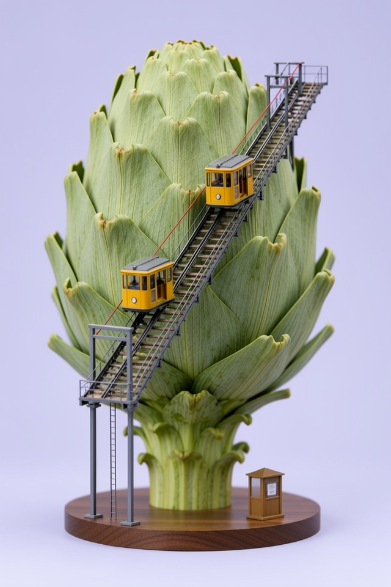
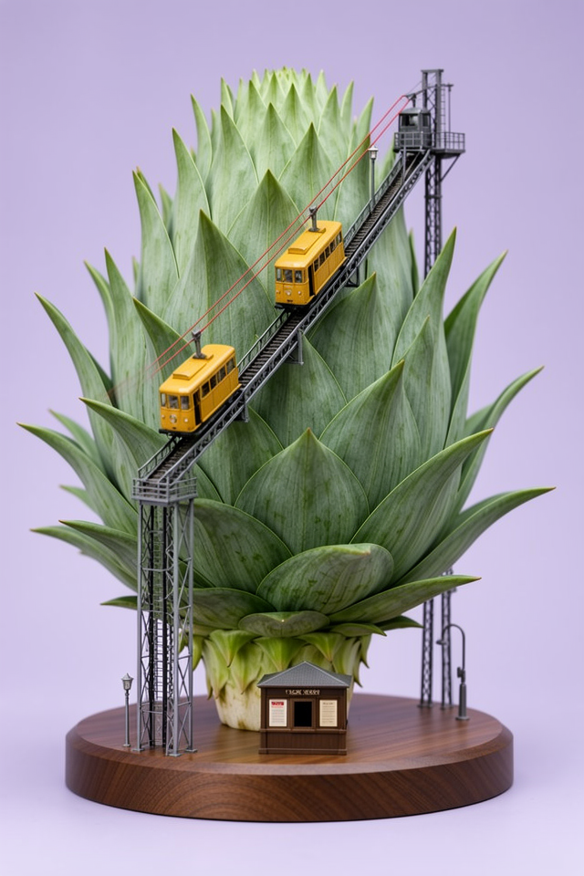
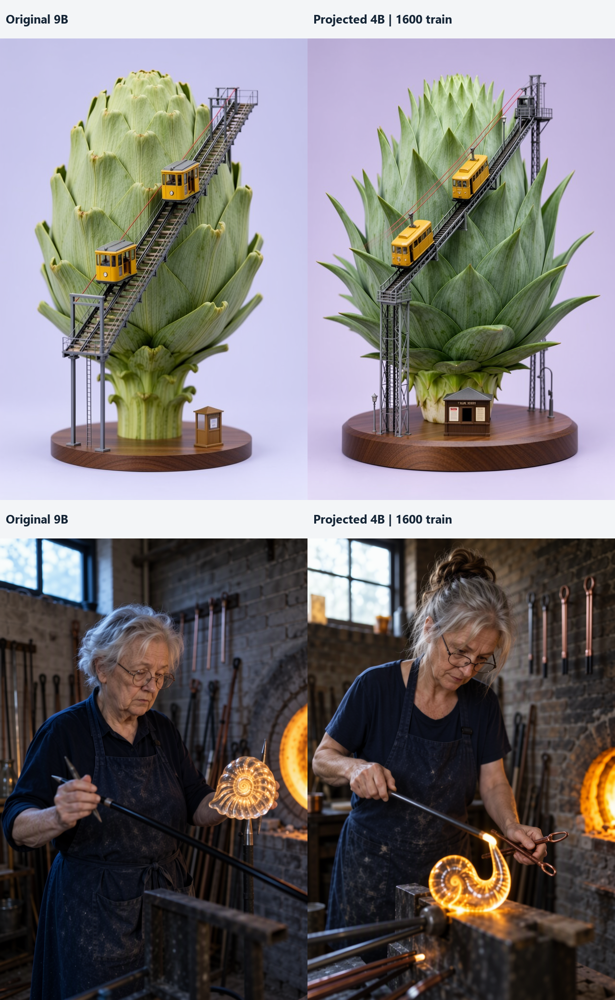

# MOSS Image Smaller Encoder

Use **Qwen3.5-4B** instead of MOSS Image's original Qwen3.5-9B text encoder in ComfyUI. Select a compatible projection adapter in a visible node, then write your prompts in the normal **CLIP Text Encode** node.

## Credits

This project was inspired by [ComfyUI-ClipProj](https://github.com/nicolab28/ComfyUI-ClipProj) by [nicolab28](https://github.com/nicolab28), which demonstrated replacing a larger text encoder with a smaller encoder and a learned feature projection. Thanks to nicolab28 for sharing the approach, calibration methods and experiments that motivated this MOSS Image adaptation.

## How this project is built

This project is **vibe coded-ish**: I use AI to help research, write code and run experiments, while I review the proposed steps, verify the work and inspect the results as development progresses. It's an AI-assisted project with hands-on human oversight, and the testing limits are documented below.

## Image comparison

Compare the original Qwen3.5-9B encoder on the left with projected Qwen3.5-4B using the **1,600-training-prompt ridge adapter** on the right. Each pair uses the same prompt, seed and settings. Click an image to view the original 640 x 960 PNG.

Both prompts were written after fitting and checked against all 2,400 calibration prompts. Neither has an exact or substantial substring match, and each scene's distinctive terms are absent from the corpus. Generic vocabulary can overlap; this does not establish absence from the encoders' pretraining data.

### Artichoke railway

A miniature funicular railway climbing a giant artichoke, with two yellow cable cars and a ticket booth. The terms "funicular," "artichoke," "cable car" and "ticket booth" do not occur in the calibration prompts.

| Original Qwen3.5-9B | Projected Qwen3.5-4B (1,600 train) |
| --- | --- |
| [](images/artichoke_original_9b.png) | [](images/artichoke_projected_4b_1600.png) |

### Glassblower

An elderly glassblower shaping a glowing glass nautilus shell in a brick workshop, with cool window light and a warm furnace. The terms "glassblower," "nautilus," "blowpipe" and "metal jacks" do not occur in the calibration prompts.

| Original Qwen3.5-9B | Projected Qwen3.5-4B (1,600 train) |
| --- | --- |
| [](images/glassblower_original_9b.png) | [](images/glassblower_projected_4b_1600.png) |

<details>
<summary>Full comparison grid, prompts and settings</summary>

[](images/encoder-comparison.png)

Both examples use seed **2026101907**, 640 x 960, 8 steps, Euler/simple, CFG 1.0, shift 5.0, and the MOSS 8-step LoRA at strength 0.8. They use the installed INT8 ConvRot 4B and 9B encoders with the same MOSS image model and VAE. Full prompt text, generation settings and image hashes are in [images/comparisons.json](images/comparisons.json).

These examples preserve the main subjects and lighting, while composition, geometry and incidental details differ. Two prompts and one seed are illustrative examples, not a broad image-quality benchmark.

</details>

## What you need

- A working MOSS Image workflow and a ComfyUI installation that supports MOSS Image and Qwen3.5.
- A Qwen3.5-4B text encoder. The tested checkpoint is [Qwen3.5-4B INT8 ConvRot](https://huggingface.co/beycanai/Qwen-LM/resolve/main/Qwen3.5-4B_int8_convrot.safetensors?download=true). Your ComfyUI installation must support loading its quantization format.
- Download the [1,600-prompt ridge projection adapter](https://github.com/bakapotatolord/moss-image-smaller-encoder/releases/download/adapter-1600-train/moss_qwen35_4b_to_9b_1600_train.safetensors) (`moss_qwen35_4b_to_9b_1600_train.safetensors`, approximately 21 MB). Weights are provided as a release download, separately from the Git checkout.

Choose **Qwen3.5-4B**, not Qwen3-VL-4B. They are different model families.

## Install

1. Place this repository in `ComfyUI/custom_nodes/moss-image-smaller-encoder`.
2. Place your Qwen3.5-4B checkpoint in `ComfyUI/models/text_encoders/`.
3. Place `moss_qwen35_4b_to_9b_1600_train.safetensors` in `ComfyUI/models/moss_encoder_adapters/`. You can also use the `adapters/` folder inside this repository.
4. Restart ComfyUI.

The node uses ComfyUI's existing Torch, safetensors and tokenizer dependencies. No additional packages are required.

## Connect your workflow

The included [workflow.json](workflow.json) uses the [MOSS Image Base 8-step DMD LoRA by Lodestones](https://huggingface.co/lodestones/MOSS-Image-Base-8-steps-dmd). Download the LoRA into `ComfyUI/models/loras/` and select it in **Load LoRA**; the workflow references it as `moss_image_8_step.safetensors`.

**Load CLIP -> Load LoRA (optional) -> MOSS Smaller Encoder Adapter -> CLIP Text Encode -> KSampler**

1. In **Load CLIP**, select your Qwen3.5-4B checkpoint and set **type** to **moss_image**.
2. Add **MOSS Smaller Encoder Adapter** from `conditioning/MOSS`.
3. Connect the CLIP output of **Load CLIP** to the adapter node. If you use **Load LoRA**, connect its CLIP output instead.
4. Select `moss_qwen35_4b_to_9b_1600_train.safetensors` in **adapter_name**.
5. Connect the adapter's CLIP output to the normal **CLIP Text Encode** node. Enter your prompt there.
6. Connect the text encoder's CONDITIONING output to KSampler's positive input.

Keep your MOSS diffusion model, VAE and sampling setup. When using Load LoRA, connect its MODEL output along your usual model path to KSampler.

For a CFG 1 workflow, connect the positive conditioning through **ConditioningZeroOut** to KSampler's negative input. To supply a separate negative prompt, connect another CLIP Text Encode node to the same adapted CLIP; higher CFG and explicit negative prompting have not been evaluated.

## Compatibility

Use a projection adapter made for **Qwen3.5-4B -> MOSS's Qwen3.5-9B feature space**. The node accepts `.safetensors` files with the `potatoforge_moss_encoder_projection_v1` format and final normalized 2560-to-4096 features. LoRA files and ClipProj adapters cannot be selected as substitutes.

You can keep compatible LoRAs before the adapter node. The adapter preserves their patches when cloning CLIP, but it does not convert a 9B text-encoder LoRA into a 4B LoRA. Real text-encoder LoRAs and scheduled encoder hooks have not been evaluated.

Use text-only prompts with the standard CLIP Text Encode node. MOSS treats prompt-weight syntax such as `(word:1.2)` as literal text. Image inputs and specialized nodes that bypass CLIP's encoding methods are unsupported.

## What to expect

This experimental release is fitted on **1,600 clean training prompts**: 800 SFW and 800 adult/NSFW prompts. A separate 400-prompt validation set selects the ridge regularization, and 400 held-out test prompts measure reconstruction. Each split is balanced SFW/adult, for 2,400 prompts total. Embedded LoRA and hypernetwork invocation tags were removed before feature collection.

On the same 400 held-out test prompts, the clean 800-prompt ridge reached **0.4132 content-token relative L2 error** and **0.9086 cosine similarity**; this 1,600-prompt adapter reaches **0.4042** and **0.9126**. That is a modest **2.17% reduction in relative L2 error**, with the same approximately 21 MB adapter size and projection architecture. Both SFW and adult-source groups improved. These are encoder-feature measurements, not image-quality scores or evidence of a visible improvement on every prompt. The test corpus has been examined in earlier experiments.

The mixed calibration corpus includes prompts from [jtatman/stable-diffusion-prompts-stats-full-uncensored](https://huggingface.co/datasets/jtatman/stable-diffusion-prompts-stats-full-uncensored). Only the learned projection is distributed here; model weights and calibration prompts are not included.

Expect differences from the original 9B encoder. The two image pairs above use the new 1,600-prompt adapter and fresh SFW prompts; they are not the older 800-prompt examples. Quality with other quantizations, longer prompts, adult image generation, editing and other generation settings has not been established.

The adapter passed the loader and projection parity checks on all 400 cached test prompts. Those checks verify saved-weight compatibility and projection math; the displayed images are separate fresh generations using the matched local 8-step workflow.

The [earlier 800-prompt release](https://github.com/bakapotatolord/moss-image-smaller-encoder/releases/tag/adapter-800-train) remains available if you prefer it.

<details>
<summary>Verify the adapter download</summary>

SHA-256 for `moss_qwen35_4b_to_9b_1600_train.safetensors`:

```text
df5ed7fa15f4c628ad6cb3539d9cd16d68f198df9cd1e07740e9bd7b162c954b
```

</details>

## How it works

The adapter node prepares a cloned CLIP branch with MOSS's prompt template and final normalized encoder output. When CLIP Text Encode runs, the adapter converts each token's 2560 features into the 4096 features MOSS expects. Projection runs on CPU in FP32, with FP16 output rounding. The encoder and diffusion-model weights stay unchanged, and you can still use the original CLIP branch separately.

## Troubleshooting

- **The adapter list is empty:** check the adapter's folder and `.safetensors` extension, then restart ComfyUI.
- **The node asks for Qwen3.5-4B:** check the selected text encoder. Qwen3-VL-4B and the original 9B checkpoint are unsupported inputs.
- **The adapter format or shape is rejected:** use a compatible MOSS projection file. Renaming another adapter or LoRA will not convert it.
- **ComfyUI cannot load the encoder checkpoint:** check that your installation supports the checkpoint's quantization format. This node applies the projection after encoder loading.
